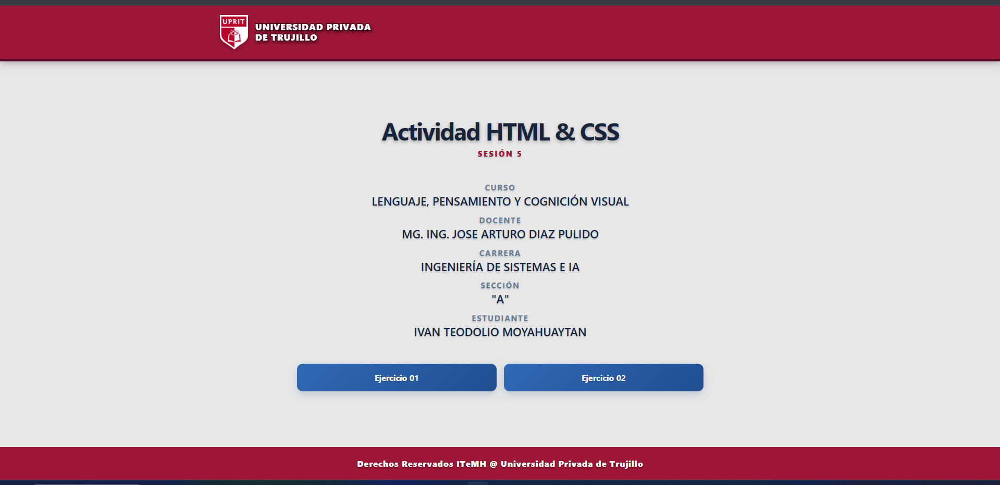
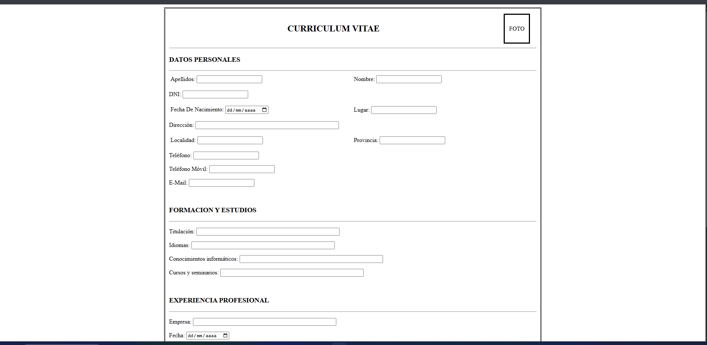
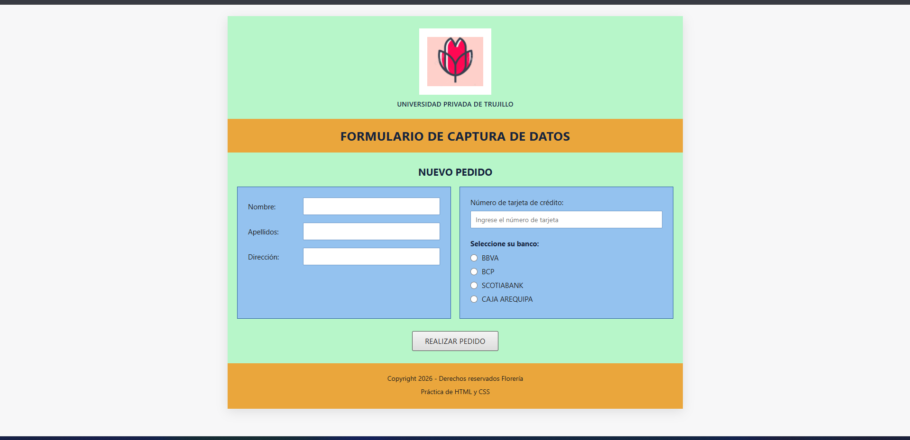

# Actividad HTML y CSS — Sesión 5

Proyecto de la **Sesión 5** del curso Lenguaje, Pensamiento y Cognición Visual. La actividad reúne a dos ejercicios prácticos orientados a la creación y el diseño de formularios web mediante HTML5 y CSS3.

## Objetivo

Aplicar los fundamentos de HTML5 y CSS3 para estructurar contenido, crear formularios, validar datos básicos y presentar interfaces claras, organizadas y adaptables a distintos tamaños de pantalla.

## Tecnologías utilizadas

- **HTML5:** estructura semántica, formularios, campos de entrada, tablas, navegación y validaciones nativas.
- **CSS3:** estilos visuales, distribución con Flexbox y Grid, diseño responsivo, estados interactivos y personalización de componentes.

## Funcionamiento de la página principal

La página principal, ubicada en `index.html`, funciona como portada y punto de acceso al contenido de la actividad. Presenta la identidad de la Universidad Privada de Trujillo, los datos académicos del curso y del estudiante, y dos botones de navegación que dirigen a cada ejercicio:

- **Ejercicio 01:** abre el formulario de currículum vitae.
- **Ejercicio 02:** abre el formulario de captura de datos de Flower Shop.

La interfaz utiliza estilos responsivos para conservar una presentación adecuada en computadoras y dispositivos móviles.

## Ejercicio 01: Formulario de currículum vitae

El primer ejercicio, disponible en `ejercicio1/index.html`, implementa un formulario para registrar información de un currículum vitae. Incluye secciones para datos personales, formación y estudios, experiencia profesional y datos complementarios.

El formulario emplea diferentes controles HTML5, como campos de texto, fecha, teléfono, correo electrónico y área de texto. También incorpora validaciones nativas para datos obligatorios y para el formato del DNI, además de botones para enviar o limpiar la información ingresada.

## Ejercicio 02: Formulario de captura de datos Flower Shop

El segundo ejercicio, ubicado en `ejercicio2/index.html`, presenta un formulario de nuevo pedido para Flower Shop. Permite capturar el nombre, los apellidos, la dirección y el número de tarjeta de crédito del cliente, así como seleccionar una entidad bancaria.

Su diseño combina HTML5 y CSS3 mediante paneles organizados con Grid, campos obligatorios, botones interactivos y reglas responsivas. La distribución se adapta a pantallas pequeñas colocando los paneles en una sola columna.

## Secuencia de desarrollo

1. Se definió la estructura general de la página principal y de los ejercicios.
2. Se incorporaron los elementos HTML5 y los campos requeridos en cada formulario.
3. Se aplicaron estilos CSS3 para mejorar la presentación, distribución e interacción.
4. Se configuró la navegación desde la portada hacia ambos ejercicios.
5. Se revisó el funcionamiento y la adaptación visual de las páginas.
6. Se registraron capturas de los resultados finales.

## Estructura del proyecto

```text
SESION5_HTML5/
├── index.html
├── README.md
├── capturas/
│   ├── 01_PRESENTACION.png
│   ├── 02_EJERCICIO_01.png
│   └── 03_EJERCICIO_02.png
├── ejercicio1/
│   └── index.html
├── ejercicio2/
│   └── index.html
└── imagenes/
    ├── INSIGNIA_UPRIT.png
    └── LOGO.png
```

## Ejecución del proyecto

No se requiere instalar dependencias ni utilizar un servidor de aplicaciones.

1. Descarga o clona el repositorio.
2. Abre la carpeta del proyecto.
3. Ejecuta `index.html` en un navegador web moderno.
4. Utiliza los botones de la página principal para acceder a los ejercicios.

También es posible abrir directamente `ejercicio1/index.html` o `ejercicio2/index.html` en el navegador.

## Capturas

### Página principal



### Ejercicio 01 — Currículum vitae



### Ejercicio 02 — Flower Shop



## Autor e institución

- **Autor:** IVAN T. MOYA HUAYTAN
- **Institución:** UNIVERSIDAD PRIVADA DE TRUJILLO
